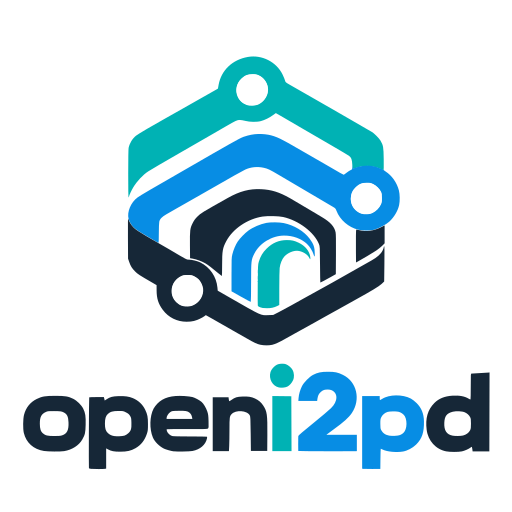

<!--
See the LICENSE file at the top of the project tree for copyright
and license details.

openi2pd: index.

Documents project documentation.

-->

# openi2pd

openi2pd is an independent fork of the i2pd C++ router implementation.

The name `openi2pd` and its geometric node/tunnel mark are the project's
product and visual identity. See the [visual identity overview](branding/README.md),
[logo usage](branding/logo-usage.md), [brand colors](branding/colors.md) and
[asset inventory](branding/assets.md). The canonical color tokens and contrast
checks live in [assets/branding/colors.md](assets/branding/colors.md).

I2P (Invisible Internet Protocol) is a universal anonymous network layer. 
All communications over I2P are anonymous and end-to-end encrypted, participants
don't reveal their real IP addresses. 

I2P client is a software used for building and using anonymous I2P 
networks. Such networks are commonly used for anonymous peer-to-peer 
applications (filesharing, cryptocurrencies) and anonymous client-server 
applications (websites, instant messengers, chat-servers).

I2P allows people from all around the world to communicate and share information
without restrictions.

Features
--------

* Distributed anonymous networking framework
* End-to-end encrypted communications
* Small footprint, simple dependencies, fast performance
* Rich set of APIs for developers of secure applications

Platforms
---------

Linux, OpenBSD, Windows and Android are supported. macOS, FreeBSD and Solaris
are outside the CMake support matrix; use upstream i2pd there. The router
binary is still named `i2pd` for compatibility.

Fork guides
-----------

* [Install openi2pd](user-guide/install.md) and [run it](user-guide/run.md)
* [Configuration](user-guide/configuration.md) and [I2P tunnels](user-guide/tunnels.md)
* [C++23 migration](cpp23-migration.md)
* [CMake and POSIX Make](build-system.md)
* [Static compilation and linkage audit](static-build-audit.md)
* [Multiprocess IPC and privilege separation](security/privilege-separation.md)
* [TUI and IPC](tui-ipc.md) and [TUI on Windows](TUI-WINDOWS.md)
* [Native BitTorrent console](torrent/architecture.md)
* [Android modernization](android-modernization.md) and [Java 25](android-java25.md)
* [Perl migration](development/perl-migration.md)
* [OpenBSD validation](security/openbsd-validation.md)

Resources
---------

* [Visual identity](branding/README.md)
* [Developer guide](developer-guide/README.md)
* [Source and issues](https://github.com/daviduhden/openi2pd)
* [I2P specifications](https://i2p.net/en/docs/specs/)
* [Upstream i2pd source (provenance)](https://github.com/PurpleI2P/i2pd)
* [Upstream documentation sync](upstream-sync.md)
