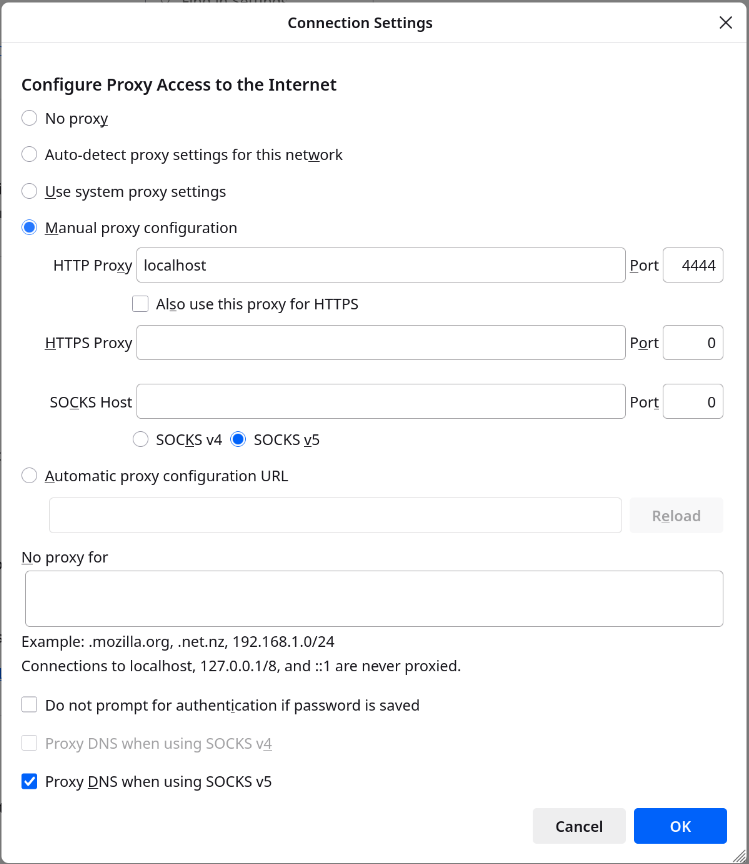

<!--
See the LICENSE file at the top of the project tree for copyright
and license details.

openi2pd: http.

Documents project documentation.

-->

Anonymous websites
==================

## Browse anonymous websites

### Manual configuration

To browse anonymous websites inside Invisible Internet, configure your web browser to use HTTP proxy 127.0.0.1:4444 (enabled by default in openi2pd).

In Firefox: Settings -> General -> Network Settings -> Configure Proxy Access to the Internet -> choose Manual proxy configuration, enter HTTP Proxy 127.0.0.1, Port 4444:

It's recommended to use an HTTP proxy when browsing, as openi2pd filters certain HTTP request headers.

In Chromium: run chromium executable with key

    chromium --proxy-server="http://127.0.0.1:4444"

Note that if you wish to stay anonymous, you’ll also need to tune your browser for better privacy. **Do your own research**.

A large list of Invisible Internet websites (eepsites) can be found at
[identiguy.i2p](http://identiguy.i2p).

## Host anonymous website

If you wish to run your own website in Invisible Internet, follow those steps:

1) Run your webserver and find out which host:port it uses (for example, 127.0.0.1:8080).

2) Configure openi2pd to create an HTTP server tunnel. Put this in your `~/.i2pd/tunnels.conf` file:

    [anon-website]
    type = http
    host = 127.0.0.1
    port = 8080
    keys = anon-website.dat

3) Restart openi2pd or send SIGHUP signal.

4) Find b32 destination of your website.

   Use `keyinfo -d anon-website.dat` or the local destinations list in `i2pd-tui` (NetDb view) to get the address. It looks like \<long random string\>.b32.i2p.

   Website is now available in Invisible Internet by visiting this address.

5) (Optional) Register short and memorable .i2p domain on [reg.i2p](http://reg.i2p), you can use the integrated `regaddr` tool (see [tools/regaddr](../tools/regaddr.md)) to generate the authentication string.
